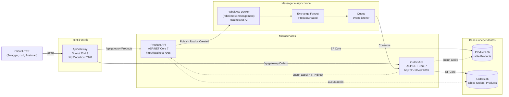
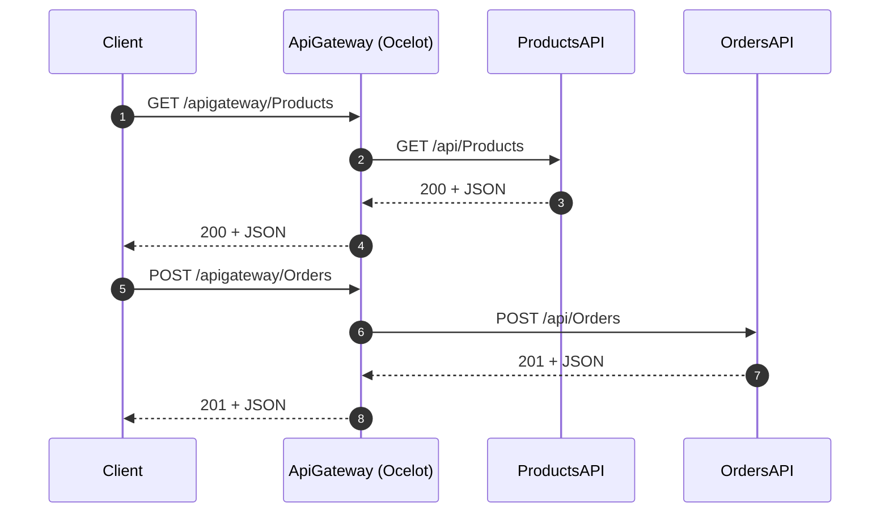
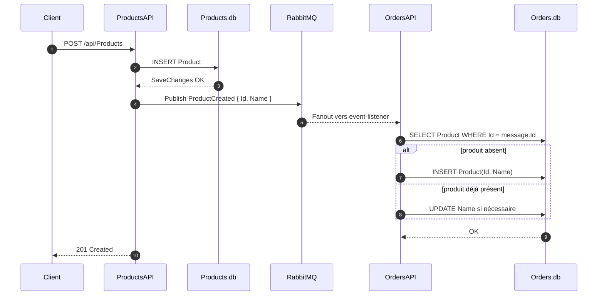
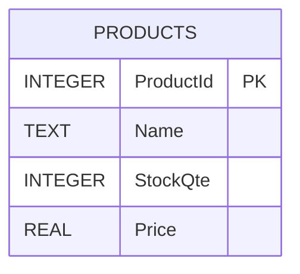
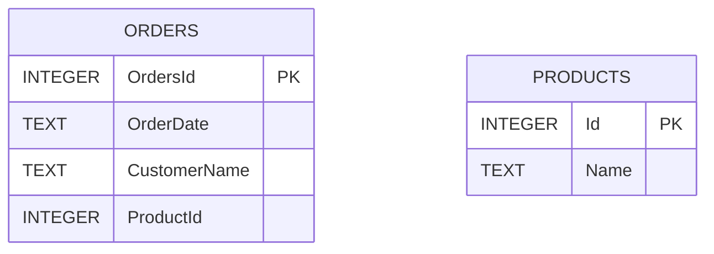

# ARCHITECTURE — MicroservicesTP

**Solution :** `MicroservicesTP`
**Style :** microservices pédagogiques avec API Gateway et communication asynchrone par événements
**Base :** SQLite, un fichier par microservice
**Broker :** RabbitMQ via Docker uniquement (`rabbitmq:3-management`, conteneur `ecomm`, ports `5672`/`15672`), abstraction MassTransit
**Gateway :** Ocelot

---

## 1. Vue d'ensemble



---

## 2. Responsabilités des projets

### 2.1 `ProductsAPI`

- Expose le CRUD REST des produits.
- Persiste les produits dans `Products.db` via `ProductsAPIContext`.
- Publie `ProductCreated` après une création réussie.
- Ne connaît ni `OrdersAPI`, ni `Orders.db`.

**Routes :**

| Méthode | Route | Rôle |
|---|---|---|
| GET | `/api/Products` | Liste des produits |
| GET | `/api/Products/{id}` | Produit par identifiant |
| POST | `/api/Products` | Création + publication |
| PUT | `/api/Products/{id}` | Mise à jour |
| DELETE | `/api/Products/{id}` | Suppression |

### 2.2 `OrdersAPI`

- Expose le CRUD REST des commandes.
- Persiste les commandes dans `Orders.db`.
- Consomme `ProductCreated` via MassTransit.
- Maintient une **projection locale** `Products(Id, Name)` dans `Orders.db`.
- Ne connaît ni `ProductsAPI`, ni `Products.db`.
- Peut démarrer et fonctionner sans `ProductsAPI` pour son CRUD.

**Routes :**

| Méthode | Route | Rôle |
|---|---|---|
| GET | `/api/Orders` | Liste des commandes |
| GET | `/api/Orders/{id}` | Commande par identifiant |
| POST | `/api/Orders` | Création |
| PUT | `/api/Orders/{id}` | Mise à jour |
| DELETE | `/api/Orders/{id}` | Suppression |

### 2.3 `ApiGateway`

- Point d'entrée unique.
- Route les requêtes vers `ProductsAPI` et `OrdersAPI`.
- Ne contient aucune logique métier.
- Ne possède pas de base de données.
- Mappe les URL publiques `/apigateway/...` vers les URL internes `/api/...`.

### 2.4 `Shared`

- Contient uniquement les contrats de messages partagés.
- `ProductCreated` est le seul contrat nécessaire.
- Aucune logique métier, aucun accès base, aucune dépendance EF Core.

### 2.5 RabbitMQ

- Broker AMQP exécuté en conteneur Docker dédié (`ecomm`, image `rabbitmq:3-management`, ports `5672`/`15672`).
- Reçoit les publications de `ProductsAPI`.
- Distribue les messages aux queues abonnées.
- La queue `event-listener` est consommée par `OrdersAPI`.

### 2.6 MassTransit

- Configure la connexion RabbitMQ.
- Sérialise/désérialise les messages.
- Gère le cycle de vie du bus et du consumer.
- Fournit `IPublishEndpoint` au publisher et `IConsumer<T>` au récepteur.

---

## 3. Communication HTTP



**Règles :**

- Le client ne contacte jamais directement les microservices pour les tests de routage.
- Les ports `7066` et `7065` sont internes à la solution ; `7162` est le port public de la Gateway.
- Ocelot ne partage aucune base et ne fait aucun accès EF Core.

---

## 4. Communication asynchrone et synchronisation



**Point clé :** la publication intervient **après** `SaveChangesAsync()`. Si la sauvegarde échoue, aucune publication n'est effectuée.

**Idempotence :** l'identifiant `ProductCreated.Id` est utilisé comme clé primaire de la projection locale. Un message rejoué ne crée pas de seconde ligne ; il met à jour le nom si nécessaire.

---

## 5. Modèle de données

### 5.1 `Products.db` — ProductsAPI



### 5.2 `Orders.db` — OrdersAPI



> Les deux tables `Products` sont **indépendantes**. Elles portent le même nom pour la lisibilité, mais vivent dans deux fichiers SQLite distincts et ne sont jamais jointes.

---

## 6. Structure de la solution

```text
MicroservicesTP/
├── MicroservicesTP.sln
├── global.json
├── .config/
│   └── dotnet-tools.json
├── Directory.Build.props
├── ProductsAPI/
│   ├── Controllers/ProductsController.cs
│   ├── Models/Product.cs
│   ├── Data/ProductsAPIContext.cs
│   ├── Migrations/
│   ├── appsettings.json
│   ├── Program.cs
│   └── ProductsAPI.csproj
├── OrdersAPI/
│   ├── Controllers/OrdersController.cs
│   ├── Models/Orders.cs
│   ├── Models/Product.cs
│   ├── Data/OrdersAPIContext.cs
│   ├── Consumer/ProductCreatedConsumer.cs
│   ├── Migrations/
│   ├── appsettings.json
│   ├── Program.cs
│   └── OrdersAPI.csproj
├── ApiGateway/
│   ├── Ocelot.json
│   ├── Program.cs
│   ├── appsettings.json
│   └── ApiGateway.csproj
├── Shared/
│   ├── Messages/ProductCreated.cs
│   └── Shared.csproj
├── Tests/
│   └── MicroservicesTP.Tests.csproj
└── scripts/
    ├── start-all.sh
    ├── stop-all.sh
    └── e2e.sh
```

---

## 7. Contrats et versions

| Élément | Version retenue | Justification |
|---|---|---|
| .NET SDK | 7.0.317 | Seule version installée avec runtime 7.0.20 ; cohérente avec EF Core 7 |
| ASP.NET Core | 7.0 | Framework cible `net7.0` |
| EF Core SQLite | 7.0.20 | Même bande que le runtime .NET 7 |
| EF Core Design | 7.0.20 | Migrations |
| dotnet-ef | 7.0.20 | Outil local de solution |
| Ocelot | 23.4.3 | Dernière version publiée avec cible `net7.0` |
| MassTransit | 8.2.3 | Cible `net6.0`, compatible `net7.0` |
| MassTransit.RabbitMQ | 8.2.3 | Même version, RabbitMQ.Client 6.8.1 |
| Swashbuckle | 6.6.2 | Compatible ASP.NET Core 7 |
| RabbitMQ | `rabbitmq:3-management` (Docker) | Conteneur unique dédié au broker (ports 5672 / 15672) |
| Erlang | Embarqué dans l'image Docker | Fourni par `rabbitmq:3-management` |

---

## 8. Décisions techniques et écarts par rapport au PDF

| Décision | PDF | Réalisation | Justification |
|---|---|---|---|
| SGBD | SQL Server | SQLite | Contrainte absolue de la mission |
| Broker | Docker `rabbitmq:3-management` (`4001:5672`) | Docker uniquement pour RabbitMQ (`rabbitmq:3-management`, `5672:5672`) | Confirmation utilisateur (`utiliser docker juste rabbitMQ`) ; APIs et SQLite restent 100% natifs |
| Port AMQP | 4001 (mapping Docker) | 5672 | Port standard confirmé par l'utilisateur |
| Port management | 15672 | 15672 | Inchangé |
| Ocelot | 18.0.0 | 23.4.3 | Compatibilité .NET 7 et maintenance |
| MassTransit | 8.x + `MassTransit.AspNetCore` | 8.2.3 + `MassTransit.RabbitMQ` | `MassTransit.AspNetCore` obsolète |
| Scheme Gateway | https | http | Évite les problèmes de certificat local ; ports conservés |
| Routes Gateway | GET/PUT/POST, POST sur `{id}` | CRUD complet | Exigence de CRUD complet |
| Table ProductsAPI | `Product` (singulier) | `Products` | Addendum SQLite et cohérence |
| Idempotence | `Id` commenté | `Id` source + clé primaire | Exigence d'idempotence |
| DELETE | Absent | Ajouté | Exigence de CRUD complet |
| Namespace Shared | `Shared.Models` | `Shared.Messages` | Structure cible demandée |

---

## 9. Flux de défaillance et limites connues

| Situation | Comportement | Limite |
|---|---|---|
| RabbitMQ arrêté au démarrage | MassTransit tente de se connecter ; les requêtes HTTP restent possibles selon l'état du bus | Le publisher peut échouer à la publication ; documenté |
| Sauvegarde produit OK, publication échoue | Le produit existe dans `Products.db`, l'API retourne une erreur explicite | Pas d'Outbox : cohérence eventual non garantie |
| Message rejoué | Le consumer détecte l'ID existant et ne duplique pas | La mise à jour du nom est appliquée |
| PUT/DELETE produit | La projection locale n'est pas mise à jour | `ProductUpdated`/`ProductDeleted` non exigés (OPTION) |
| OrdersAPI arrêté | Les messages restent dans la queue `event-listener` | Reprise à la réactivation |
| ProductsAPI arrêté | OrdersAPI continue de servir ses commandes | Indépendance respectée |

---

## 10. Sécurité

- Aucune authentification dans le périmètre du TP (non demandée).
- Aucun secret réel dans le code : les identifiants RabbitMQ sont lus depuis la configuration.
- Les valeurs locales par défaut (`guest`/`guest`) sont celles d'une installation RabbitMQ de développement.
- En production : variables d'environnement, user-secrets ou gestionnaire de secrets.
- Les chaînes de connexion SQLite ne contiennent pas de mot de passe.
- Les fichiers `.db` et `appsettings.*.local.json` sont exclus du versionnement.

---

## 11. Critères d'architecture respectés

- [x] Un fichier SQLite par microservice.
- [x] Aucun DbContext partagé.
- [x] Aucune jointure inter-bases.
- [x] Aucun appel direct OrdersAPI → ProductsAPI pour la synchronisation.
- [x] `Shared` limité au contrat de message.
- [x] Gateway sans logique métier.
- [x] Publisher après sauvegarde.
- [x] Consumer idempotent.
- [x] Ports cohérents entre Ocelot et les API.
